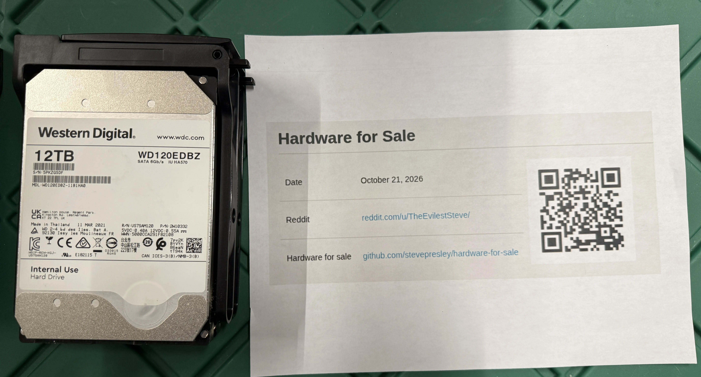

WDC WD120EDBZ-11B1HA0 | 12 TB, 7200 rpm
Serial: 5PKZGSDF
Power-on hours: 37,781 | SMART: PASSED
Reallocated / pending / offline-uncorrectable sectors: 0 / 0 / 0
UDMA CRC errors: 0 | SMART error log: none
SMART capture time: 2026-10-21 20:44 UTC

## Drive image



## SMART details

```text
smartctl 7.4 2023-08-01 r5530 [x86_64-linux-6.6.44-production+truenas] (local build)

=== START OF INFORMATION SECTION ===
Device Model:     WDC WD120EDBZ-11B1HA0
Serial Number:    5PKZGSDF
Firmware Version: 85.00A85
User Capacity:    12,000,138,625,024 bytes [12.0 TB]
Sector Sizes:     512 bytes logical, 4096 bytes physical
Rotation Rate:    7200 rpm
Form Factor:      3.5 inches
SMART overall-health self-assessment test result: PASSED

SMART Attributes:
  5 Reallocated_Sector_Ct: 0
  9 Power_On_Hours: 37781
 22 Helium_Level: 100
194 Temperature_Celsius: 33 (Min/Max 17/66)
196 Reallocated_Event_Count: 0
197 Current_Pending_Sector: 0
198 Offline_Uncorrectable: 0
199 UDMA_CRC_Error_Count: 0

SMART Extended Comprehensive Error Log:
No Errors Logged

SMART Extended Self-test Log:
One extended offline test completed without error at 34402 power-on hours.

SCT Status:
Current Temperature: 33 Celsius
Lifetime Min/Max Temperature: 17/66 Celsius
Specified Max Operating Temperature: 65 Celsius

Device Statistics:
Power-on Hours: 37781
Number of Reallocated Logical Sectors: 0
Number of Reported Uncorrectable Errors: 0
Number of Interface CRC Errors: 0
Pending Defects log: No Defects Logged
```
