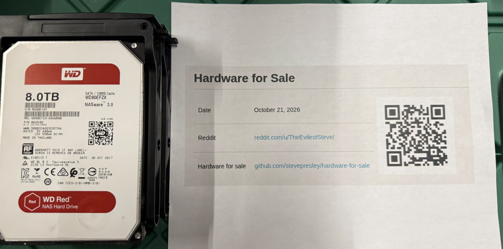

WDC WD80EFZX-68UW8N0 | 8 TB, 5400 rpm
Serial: R6GNK1GY
Power-on hours: 65,545 | SMART: PASSED
Reallocated / pending / offline-uncorrectable sectors: 0 / 0 / 0
UDMA CRC errors: 0 | SMART error log: none
Device Statistics report 1,460 read-recovery attempts; logged self-tests completed without error.
SMART capture time: 2026-10-21 20:44 UTC

## Drive image



## SMART details

```text
smartctl 7.4 2023-08-01 r5530 [x86_64-linux-6.6.44-production+truenas] (local build)

=== START OF INFORMATION SECTION ===
Model Family:     Western Digital Red Plus
Device Model:     WDC WD80EFZX-68UW8N0
Serial Number:    R6GNK1GY
LU WWN Device Id: 5 000cca 263c9576a
Firmware Version: 83.H0A83
User Capacity:    8,001,563,222,016 bytes [8.00 TB]
Sector Sizes:     512 bytes logical, 4096 bytes physical
Rotation Rate:    5400 rpm
Form Factor:      3.5 inches
SMART overall-health self-assessment test result: PASSED

SMART Attributes:
  5 Reallocated_Sector_Ct: 0
  9 Power_On_Hours: 65545
 22 Helium_Level: 100
194 Temperature_Celsius: 33 (Min/Max 10/54)
196 Reallocated_Event_Count: 0
197 Current_Pending_Sector: 0
198 Offline_Uncorrectable: 0
199 UDMA_CRC_Error_Count: 0

SMART Extended Comprehensive Error Log:
No Errors Logged

SMART Extended Self-test Log:
19 short and extended offline tests are listed; all completed without error.

SCT Status:
Current Temperature: 33 Celsius
Lifetime Min/Max Temperature: 10/54 Celsius
Under/Over Temperature Limit Count: 0/0

Device Statistics:
Power-on Hours: 65545
Read Recovery Attempts: 1460
Number of Reallocated Logical Sectors: 0
Number of Reported Uncorrectable Errors: 0
Number of Interface CRC Errors: 0
Pending Defects log: not supported
```
